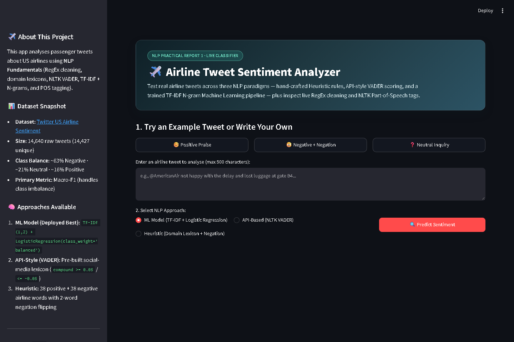
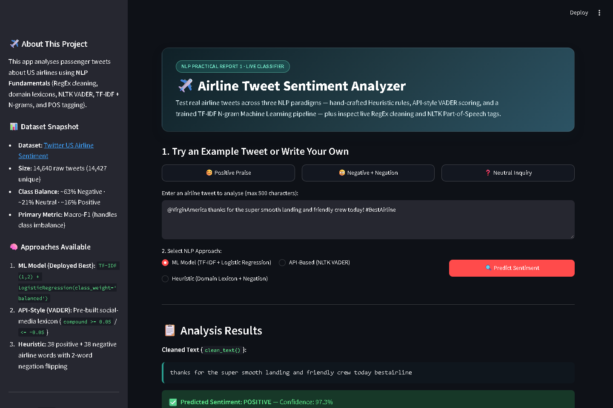
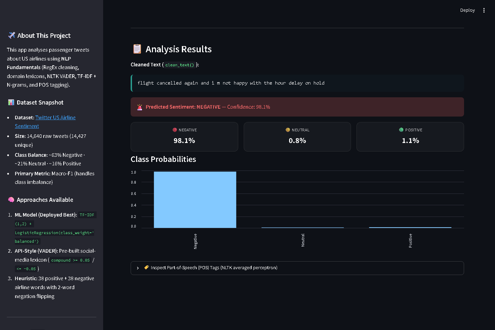
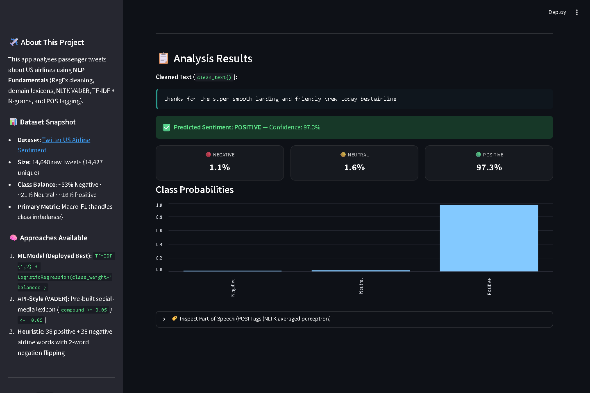
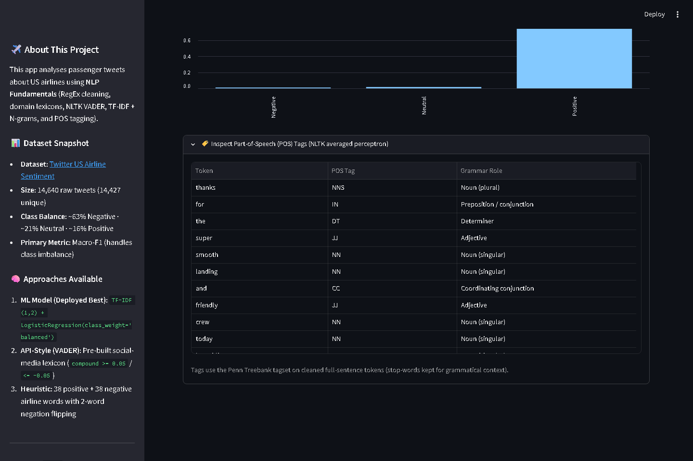
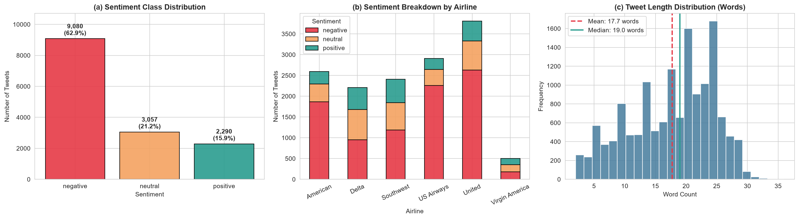
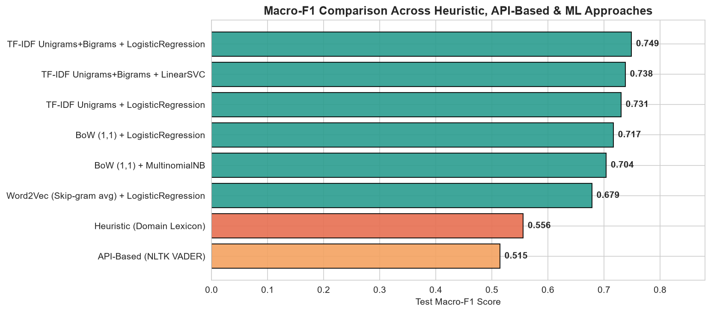
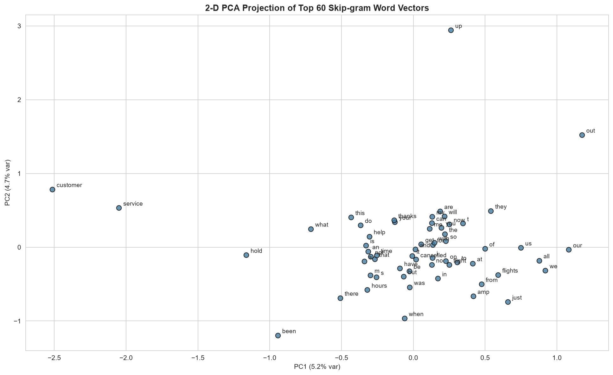
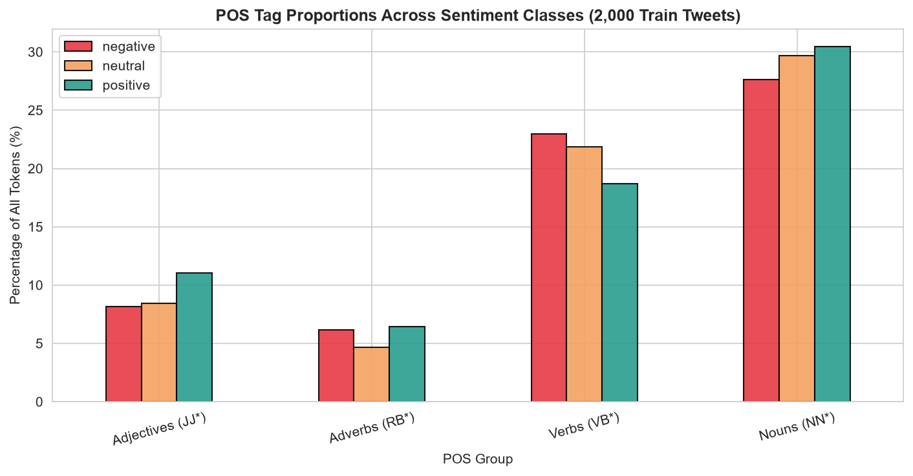

# ✈️ Airline Tweet Sentiment Analyzer (NLP PR 1)

> **🚀 Live Streamlit App:** **[https://ftcrgyedrxszcvhbmpkjpm.streamlit.app/](https://ftcrgyedrxszcvhbmpkjpm.streamlit.app/)**

**Institute:** Red & White Skill Education | **Subject:** Natural Language Processing (NLP) — Practical Report 1 (PR 1)  
**Dataset:** [Twitter US Airline Sentiment (Kaggle)](https://www.kaggle.com/datasets/crowdflower/twitter-airline-sentiment) — 14,640 real passenger tweets (14,427 unique after de-duplication) labelled `negative` (~63%), `neutral` (~21%), and `positive` (~16%).

---

## 📌 Project & Pipeline Summary

This project builds and compares three NLP paradigms—**Heuristic Rules**, **API-Style Scoring (NLTK VADER)**, and **Machine Learning Pipelines**—from raw noisy tweets to a deployed interactive Streamlit web application.

```text
Raw Tweet ─▶ clean_text() (RegEx) ─▶ Tokenisation & Negation-Preserved Stop-Words
     ─▶ Feature Extraction (BoW / TF-IDF / N-Grams / Word2Vec)
     ─▶ Classifier (Logistic Regression / LinearSVC / Naive Bayes)
     ─▶ Macro-F1 Evaluation & 5-Fold CV ─▶ sentiment_model.joblib ─▶ Streamlit App
```

- **Shared Code Architecture:** Both [NLP_PR1.ipynb](NLP_PR1.ipynb) and [app.py](app.py) import `clean_text()`, `POSITIVE_LEXICON`, `NEGATIVE_LEXICON`, and `heuristic_sentiment()` directly from [nlp_utils.py](nlp_utils.py) so preprocessing and rule logic never diverge.
- **Leak-Free Evaluation:** Stratified 80/20 split (`random_state=42`) performed *before* fitting any `CountVectorizer`, `TfidfVectorizer`, or `Word2Vec` model.

---

## 📊 Results Comparison Table

All approaches were evaluated on the exact same held-out 20% stratified test set (**2,886 tweets**). Because classes are imbalanced (63% negative), **Macro-F1** is our primary metric.

| Family | Approach | Accuracy | Macro-F1 | Precision (Negative) | Recall (Positive) |
|---|---|---:|---:|---:|---:|
| **ML-Based (Deployed)** | **TF-IDF Unigrams+Bigrams + Logistic Regression** | **0.7952** | **0.7492** | **0.8899** | **0.7533** |
| ML-Based | TF-IDF Unigrams+Bigrams + LinearSVC | 0.7983 | 0.7383 | 0.8577 | 0.7118 |
| ML-Based | TF-IDF Unigrams + Logistic Regression | 0.7717 | 0.7307 | 0.8936 | 0.7751 |
| ML-Based | BoW (1,1) + Logistic Regression | 0.7609 | 0.7169 | 0.8953 | 0.7620 |
| ML-Based | BoW (1,1) + Multinomial Naive Bayes | 0.7810 | 0.7041 | 0.8170 | 0.6659 |
| ML-Based | Word2Vec (Skip-gram avg) + Logistic Regression | 0.7308 | 0.6787 | 0.8726 | 0.7162 |
| Heuristic | Domain Lexicon (38 pos / 38 neg) + Negation Flip | 0.5426 | 0.5560 | 0.9229 | 0.6703 |
| API-Based | NLTK VADER (Compound Polarity) | 0.5489 | 0.5146 | 0.9001 | 0.8821 |

- **5-Fold Stratified CV (Train only) for Deployed Pipeline:** `0.7370 ± 0.0080` Macro-F1 (close to held-out test `0.7492`, confirming zero overfitting).
- **POS-Filtered Ablation (Task 7.5):** Restricting tokens to `JJ*`, `RB*`, `VB*`, and negations dropped Macro-F1 from `0.7492` to `0.6321` because domain nouns (`luggage`, `hold`, `hours`, `baggage`) carry strong complaint signal.

---

## 🧠 Short Explanation of NLP Topics Used

1. **RegEx Text Cleaning & Negation-Kept Stop-Words:** Lowercases tweets, strips URLs (`https?://\S+`) and `@mentions` (`@\w+`) before punctuation removal, unwraps `#hashtags` (`#(\w+)` → `\1`), and removes non-letters while preserving `no`, `not`, `nor`, and `never` so phrases like `"not happy"` are never inverted.
2. **Heuristic & API-Based Approaches:** Hand-crafted domain lexicon with a 2-word negation flip window (`heuristic_sentiment`) vs. ready-made social-media polarity scoring (`SentimentIntensityAnalyzer` VADER), highlighting why general engines miss airline-specific terms (`flightled`, `hold`).
3. **Bag-of-Words (BoW), TF-IDF & N-Grams:** Verified manual matrix and IDF math ($\ln(N/\text{df}) + 1$) against scikit-learn. Adding bigrams (`ngram_range=(1,2)`) captures multi-word cues (`on hold`, `customer service`, `thank you`) while `min_df=2` removes single-tweet noise.
4. **Word2Vec (CBoW & Skip-gram):** Trained 100-D dense embeddings (`seed=42, workers=1`) and projected top 60 words via 2-D PCA. Averaging word vectors loses word order and dilutes sharp sentiment words on short tweets.
5. **Text Classification Pipeline:** Bundled `TfidfVectorizer(ngram_range=(1,2), min_df=2)` and `LogisticRegression(max_iter=1000, class_weight='balanced')` inside a single `Pipeline` saved to [sentiment_model.joblib](sentiment_model.joblib).
6. **POS Tagging:** Inspected NLTK's averaged-perceptron `pos_tag` ambiguity resolution (`book` as `VB` vs `NN`), compared POS distributions across 2,000 tweets, and exposed live token-level POS tagging inside an `st.expander` in the Streamlit app.

---

## 💻 How to Run Locally

1. **Clone the repository and enter the folder:**
   ```bash
   git clone <YOUR_PUBLIC_REPO_URL>
   cd airline-tweet-sentiment-analyzer
   ```
2. **Install pinned dependencies:**
   ```bash
   pip install -r requirements.txt
   ```
3. **Launch the Streamlit app:**
   ```bash
   streamlit run app.py
   ```
   *(NLTK corpora are downloaded automatically on first startup inside `try/except`.)*

To re-run the analysis notebook (`NLP_PR1.ipynb`), download `Tweets.csv` from the [Kaggle dataset page](https://www.kaggle.com/datasets/crowdflower/twitter-airline-sentiment) into the project root and run all cells.

---

## 📸 Screenshots

### Live Streamlit App Screenshots

| Start Screen | Positive Prediction |
| :---: | :---: |
|  |  |
| *Initial landing UI with sidebar, example buttons, and approach selector.* | *Positive prediction with green banner, confidence pills, and probability chart.* |

| Negative Prediction | Probability Chart & Metrics |
| :---: | :---: |
|  |  |
| *Negative prediction handling negation (`NOT happy`) and URL cleaning.* | *Class probability bar chart (`st.bar_chart`) rendered for the ML pipeline.* |

| NLTK POS Tag Expander |
| :---: |
|  |
| *Collapsible `st.expander` showing token-level Penn Treebank POS tags.* |

### Notebook Analysis Charts

- **EDA & Class Imbalance:** 
- **All-Approach Macro-F1 Comparison:** 
- **Skip-gram Word2Vec 2-D PCA Projection:** 
- **POS Tag Distribution by Sentiment:** 

---

## 🎥 Video Explanation

- **Video Link:** `[Add your 5–10 min Google Drive or Unlisted YouTube link here]`
- **File Naming Convention:** `NLP_PR1_YourName_GRID.mp4`

---

## 🛠️ Tools & Pinned Versions

Trained and verified with **Python 3.12.0** and **`scikit-learn==1.9.0`** (matching `requirements.txt` so `sentiment_model.joblib` loads cleanly on Streamlit Community Cloud):

- `streamlit==1.65.0`
- `scikit-learn==1.9.0`
- `nltk==3.10.4`
- `pandas==2.3.3`
- `numpy==2.5.4`
- `joblib==1.5.3`
- `gensim==4.4.0` *(used in `NLP_PR1.ipynb` for Word2Vec)*
